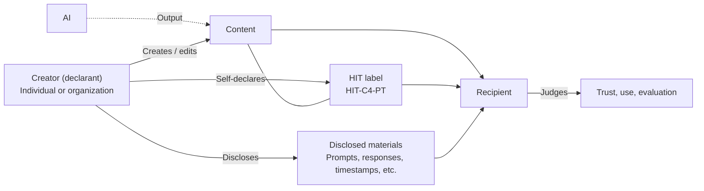
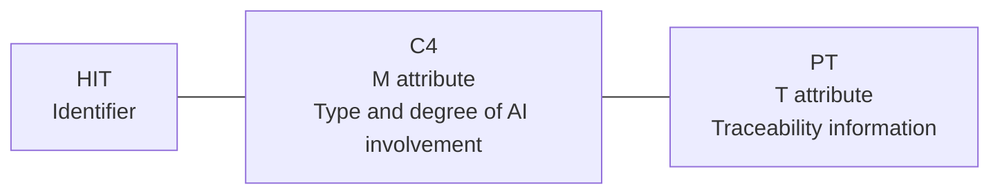
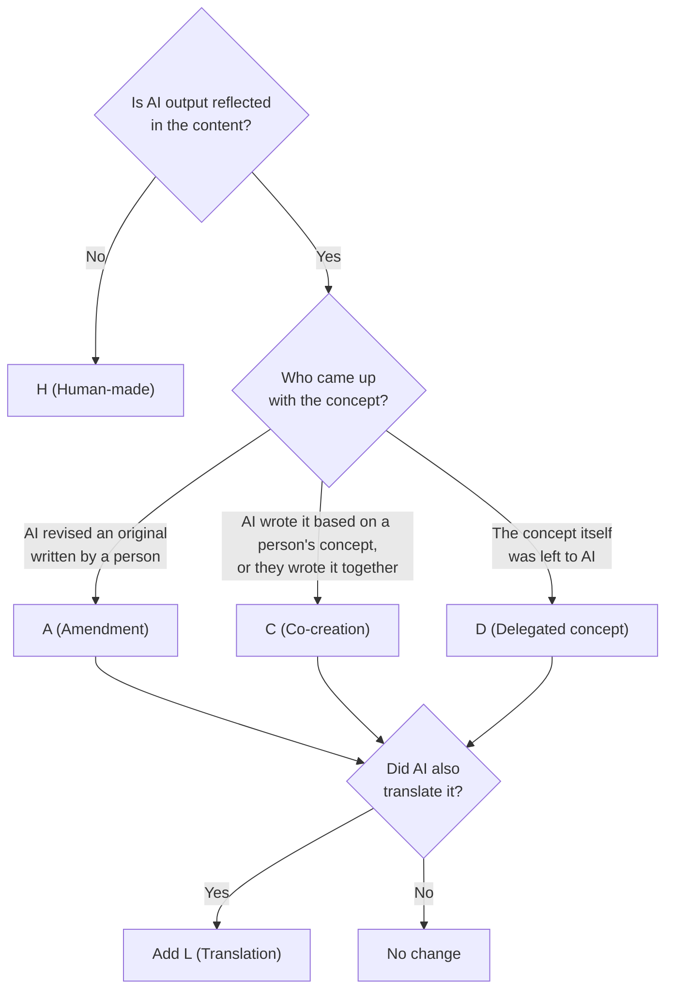

<div align="right">

**EN** | [JA](./ja/index.md)

</div>

<div align="center">

# `HIT-C4-PT`

**AI created about 40% · Prompts, AI responses, and timestamps disclosed**

How much was AI involved in this content?<br/>
**HIT** tells you in a single line.

</div>

---

## What is HIT?

HIT (Human Indication and Traceability) is a **self-declared label** for content made with AI.

You can attach it to any kind of content, including text, images, audio, video, and software. The label alone tells recipients two things:

1. **How, and how much, AI was involved**
2. **How much information is disclosed for tracing how the content was made**

HIT is neither a law nor a license. It is a shared format that lets creators state the facts in their own words.

---

## What HIT Offers

| Who | Expected benefit |
| --- | --- |
| Creators and AI users | You can describe your use of AI honestly and briefly. You can show which parts you made yourself and which parts relied on AI. |
| Recipients of content | You can decide how to read, use, or evaluate what you receive, knowing how much AI was involved. |
| Society as a whole | HIT builds a human chain of trust that shows who took responsibility for releasing the content. |

HIT also aims to serve the following social roles:

- **Protecting human creativity:** HIT helps prevent truly spontaneous human creativity from being lost as AI output blends into human culture without limit.
- **Supporting fair discussions of compensation:** By distinguishing AI output from human intellectual work, HIT provides a basis on which rights holders and collective management organizations can discuss how compensation should be distributed.
- **Coexisting with existing rules:** HIT does not replace Creative Commons, open-source licenses, or commercial contracts. It is used alongside them.

---

## Concept

Only people (individuals or legal entities) can bear legal responsibility. With HIT, the declarant is **a person**, not the AI, and that person states the facts to recipients.



---

## How to Read a Label

A HIT label consists of three parts joined by hyphens (`-`).



| Part | Meaning | In the example `HIT-C4-PT` |
| --- | --- | --- |
| `HIT` | Identifier showing that this is a HIT label | — |
| M attribute | **How** and **how much** AI was involved | `C4`: co-creation; AI created about 40% |
| T attribute | **What** information is disclosed for tracing how the content was made | `P`: prompts and AI responses; `T`: timestamps |

### Flags and Degrees

- A **flag** is a single uppercase letter. It represents a type of involvement or a type of disclosed information.
- A **degree** is an integer from 1 to 10 that follows an M-attribute flag. It shows, on a 10-step scale, the share of the whole content that AI was involved in. `1` means about 10%, and `10` means the whole.
- If AI was involved in less than 10% of the content, use `1`. If AI was involved in nearly all of it but less than 100%, use `9`.
- When you write more than one M-attribute flag, separate them with a slash (`/`). For example, `C3/L10` means "AI created about 30% of the content, and AI also translated the entire text."
- T-attribute flags take no degree and are written one after another (for example, `SPORT`).

---

## Available Flags

### M Attribute (Manipulation: AI Involvement)

| Flag | Name | Meaning | Degree |
| --- | --- | --- | --- |
| `C` | Co-creation | AI created the content based on a human's concept, or a human and AI created it together. | Required |
| `D` | Delegated concept | The concept was left to AI, and a human gave further instructions and made selections. | Required |
| `A` | Amendment | AI corrected, edited, or partially revised an original work made by a human. | Required |
| `L` | Translation | AI translated an original work. | Required |
| `H` | Human-made | AI was not involved. | None |

The following rules apply to combinations:

- `H` cannot be combined with any other flag.
- `C` and `D` cannot be combined with each other.
- `A` and `L` can be combined with `C` or `D`.

If you are unsure which flag to choose, use the chart below as a guide.



### T Attribute (Traceability: Information for Tracing)

| Flag | Name | Disclosed information |
| --- | --- | --- |
| `S` | System prompt | The system prompt that the creator set or was able to obtain |
| `P` | Prompts and responses | The full text of the instructions given to AI and of the AI's responses |
| `O` | Original | The original work, or the AI-generated content before human editing |
| `R` | References | A list of materials given to AI or consulted by AI |
| `T` | Timestamps | The dates or datea and times of creation and editing |
| `V` | Verification | Proof of the model and the creator by digital signature or digital watermark |
| `N` | None | No traceability information is disclosed (cannot be combined with other flags) |

A label without a T attribute (for example, `HIT-C4`) means the same as a label with `N` (`HIT-C4-N`).

"Disclosure" does not only mean publishing to everyone. It also includes providing information only to the other party of a contract. Even when a work in progress is intended only for a specific party, such as a client, HIT gives useful clues about where the content came from.

---

## Example Labels

| HIT label | Meaning |
| --- | --- |
| `HIT-H` | A person made it. AI was not involved. |
| `HIT-A2-N` | AI revised about 20% of a text written by a person. |
| `HIT-C4-PT` | AI created about 40% based on a person's concept. Prompts, AI responses, and timestamps are disclosed. |
| `HIT-A1/L10-POR` | AI revised about 10% of an original written by a person and translated the entire text. Prompts and responses, the original and the AI-generated content before editing, and a list of references are disclosed. |
| `HIT-C3/L10` | AI created about 30% and translated the entire text. No traceability information is disclosed (same as `HIT-C3/L10-N`). |
| `HIT-D10-PT` | The concept was left to AI, and the whole was created through a person's instructions and selections. Prompts, responses, and timestamps are disclosed. |
| `HIT-C10-SP` | AI created the whole, and a person reviewed it. The system prompt, prompts, and responses are disclosed. |
| `HIT-H-TV` | A person made it, and AI was not involved. The creation date and time are disclosed, and the creator can be verified by digital signature. |

### How to Attach a Label

Write the label as copyable text in a place where recipients will normally notice it. Good places include the following:

- **Documents:** near the license notice at the beginning or end
- **Images and videos:** the caption or description
- **Software:** a comment at the top of each source file, or the README

We also recommend noting the AI you used and the date.

```text
HIT-C4-PT
AI: <provider> <model>
Created: 2026-11-15
Disclosures: <where they are published>
```

---

## What HIT Does Not Do

- **HIT does not determine copyright.** Whether rights arise in the parts made by AI depends on the laws of each country.
- **HIT does not change licenses.** A HIT label is placed beside the license notice. If the two appear to conflict, the license prevails.
- **HIT does not impose obligations.** HIT is a self-declaration standard. It recommends declaring accurately and, when in doubt, estimating AI involvement on the higher side.

---

## For Developers

At present, only the specification for **L0**, the human-readable label level, is available. The specifications for machine-readable metadata (L1) and signature-based verification (L2) have not yet been finalized.

For details, see [HIT Annotation Specification L0 (Label Notation)](https://github.com/hit-annotation/spec/blob/v0.1.1/HIT-L0-spec.md) (in Japanese).

Issues and pull requests are welcome for further discussion.

---

## About This Page

This page itself is also subject to HIT.

```text
HIT-C9/L10-SPORT
AI: Anthropic Claude Opus 5.5
Created: 2026-11-15
Disclosures: see the table below
Original label (Japanese version): HIT-C9-SPORT
```

| Flag | Content | Location |
| --- | --- | --- |
| `S` | The system prompt set by the declarant. Non-public parts set by the platform operator are not included. | [archives/prompts](https://github.com/hit-annotation/spec/tree/main/archives/prompts) |
| `P` | The full text of the prompts used to create this page, including its translation, and of the AI's responses | [archives/prompts](https://github.com/hit-annotation/spec/tree/main/archives/prompts) |
| `O` | The Japanese original of this page, and the AI-generated content before editing. Both can be traced through the repository's commit history. | [Japanese version](../ja/index.md), [hit-annotation/spec](https://github.com/hit-annotation/spec) |
| `R` | References: HIT Annotation Specification L0 v0.1.1, and the draft "HIT Annotation Overview" | [Specification](https://github.com/hit-annotation/spec/blob/v0.1.1/HIT-L0-spec.md), [Draft](https://github.com/hit-annotation/spec/blob/v0.1.0/HIT-base-doc-v0.0.1.md) |
| `T` | Created: 2026-11-15. Editing dates and times are recorded in the repository's commit history. | This page |

This page is licensed under [Creative Commons Attribution 4.0 International (CC BY 4.0)](https://creativecommons.org/licenses/by/4.0/).

© 2026 [HIT Annotation Group](https://github.com/hit-annotation)
