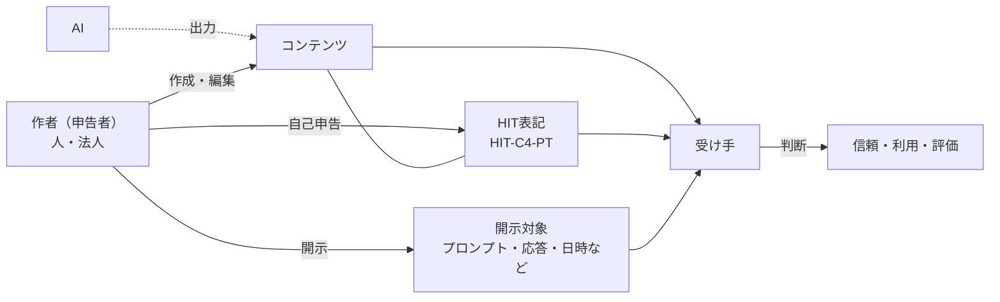
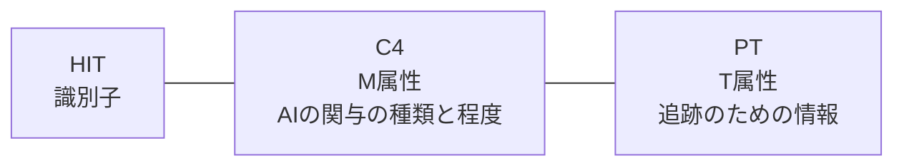
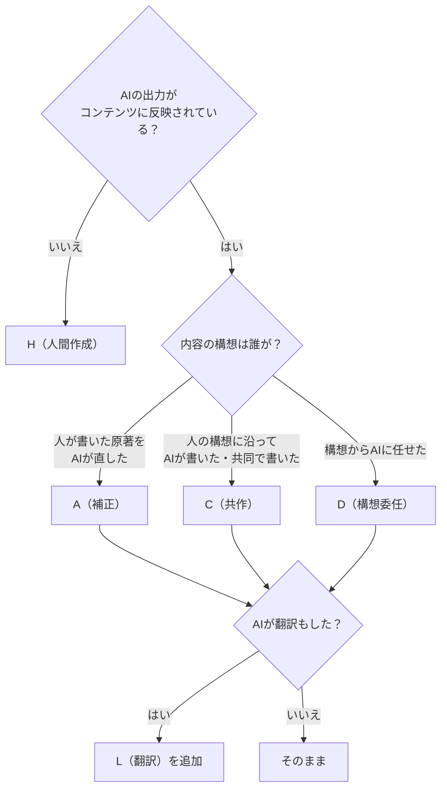

<div align="right">

[EN](../index.md) | **JA** 

</div>

<div align="center">

# `HIT-C4-PT`

**AIがおよそ4割を作成 ／ プロンプトとAIの応答、作成日時を開示**

このコンテンツに、AIがどれだけ関わったか。<br/>
それを一行で伝えるのが **HIT（人証）** です。

</div>

---

## HIT（人証）とは

HIT（Human Indication and Traceability、人跡証憑/人証）は、AIを使って作ったコンテンツに付ける**自己申告のラベル**です。

文章、画像、音声、映像、プログラムなど、あらゆるコンテンツに付けられます。このラベルを示すだけで、次の2つの事柄を簡単に伝えられます:

1. **AIがどのように、どれくらい関わったか**
2. **作られた過程をたどる情報が、どこまで公開されているか**

HITは法律やライセンスではありません。作者が自分の言葉で事実を表明するための、共通の書き方です。

---

## HITで期待できること

| 対象 | 期待できる効果 |
| --- | --- |
| 作者・AI利用者 | AIの使い方を正直に、短く伝えられます。自分の力で作った部分と、AIに頼った部分を区別して示せます。 |
| コンテンツの受け手 | 受け取ったものに、AIがどれだけ関わったかを知ったうえで、読む、使う、評価する、といった判断ができます。 |
| 社会全体 | 「誰が責任を持って世に出したのか」をたどれる、人間による信頼の鎖をつくります。 |

さらに、HITは次のような社会的役割を果たすことを目指しています。

- **人間の創造性を守る:** AIの出力が際限なく人類文化に混ざり込むことによって、人類から真に自発的な創造性が奪われることを防ぎます。
- **公正な対価の議論を支える:** AIによる成果と人の知的生産を区別して示すことで、権利者や管理団体が対価の配分を議論するための土台を作ります。
- **既存のルールと共存する:** クリエイティブ・コモンズやオープンソースライセンス、商契約などを置き換えず、それらと横並びにして使えます。

---

## コンセプト

法的な責任を負えるのは、人（個人または法人）だけです。HITでは、AIではなく**人が申告者**になり、受け手に向けて事実を表明します。



---

## ラベルの読み方

HIT表記は、三つの部分をハイフン `-` でつないだものです。



| 部分 | 意味 | 例 `HIT-C4-PT` の場合 |
| --- | --- | --- |
| `HIT` | HIT表記であることを示す識別子 | ― |
| M属性 | AIが**どのように**、**どれくらい**関わったか | `C4`: 共作で、AIがおよそ4割を作成 |
| T属性 | 作られた過程をたどる情報として、**何を**公開しているか | `P`: プロンプトとAIの応答、`T`: 日時 |

### フラグと度数値

- **フラグ**は、関与の種類や公開している情報の種類を表す、英大文字1字の記号です。
- **度数値**は、M属性のフラグの後ろに付ける 1 から 10 の整数です。コンテンツ全体のうち、AIが関わった部分の割合を10段階で表します。`1` はおよそ1割、`10` は全体です。
- 関与があっても1割に満たない場合は `1`、ほぼ全体でも10割に満たない場合は `9` とします。
- M属性に複数のフラグを書くときは、スラッシュ `/` で区切ります。たとえば `C3/L10` は「AIがおよそ3割を作成し、さらに全文をAIが翻訳した」という意味です。
- T属性のフラグには度数値を付けず、続けて書きます（例: `SPORT`）。

---

## 指定できるフラグ

### M属性（Modification: AIの関与）

| フラグ | 名称 | 意味 | 度数値 |
| --- | --- | --- | --- |
| `C` | 共作 | 人間の構想に基づいてAIが作成した。または人間とAIが共同で作成した。 | 必要 |
| `D` | 構想委任 | AIに構想を委ね、人間が追加の指示と選択を行って作成した。 | 必要 |
| `A` | 補正 | 人間が作った原著を、AIが補正、校訂、または部分的に修正した。 | 必要 |
| `L` | 翻訳 | AIが原著を翻訳した。 | 必要 |
| `H` | 人間作成 | AIは関わっていない。 | 付けない |

組み合わせには、次のルールがあります。

- `H` は、ほかのフラグと一緒に使えません。
- `C` と `D` は、一緒に使えません。
- `A` と `L` は、`C` や `D` と一緒に使えます。

どのフラグを選べばよいか迷ったときは、次の図を目安にしてください。



### T属性（Traceability: 追跡のための情報）

| フラグ | 名称 | 公開している情報 |
| --- | --- | --- |
| `S` | システムプロンプト | 作者が設定した、または入手できたシステムプロンプト |
| `P` | プロンプトと応答 | AIへの指示文と、AIの応答の全文 |
| `O` | 原本 | 原著、または人が編集する前のAI生成コンテンツ |
| `R` | 参照情報 | AIに与えた、またはAIが参照した資料の一覧 |
| `T` | 時刻情報 | 作成や編集の日時 |
| `V` | 電子的証明 | 電子署名や電子透かしによる、モデルと作者の証明 |
| `N` | なし | 追跡のための情報は開示していない（ほかのフラグと併用不可） |

T属性を省略した表記（例: `HIT-C4`）は、`N` を書いた表記（`HIT-C4-N`）と同じ意味です。

「開示」は、一般公開だけを意味しません。契約の相手だけに提供する場合も含みます。制作中や執筆中の成果物が特定の相手（例えばお客様）だけに対するものであっても、HITはコンテンツの来歴を示す有益な手がかりとなります。

---

## ラベルの例

| HIT表記 | 意味 |
| --- | --- |
| `HIT-H` | 人が作成し、AIは関わっていない。 |
| `HIT-A2-N` | 人が書いた文章を、AIがおよそ2割補正した。 |
| `HIT-C4-PT` | 人の構想に沿ってAIがおよそ4割を作成した。プロンプトとAIの応答、日時を開示している。 |
| `HIT-A1/L10-POR` | 人が書いた原著を、AIがおよそ1割補正し、全文を翻訳した。プロンプトと応答、原著と編集前のAI生成コンテンツ、参照資料の一覧を開示している。 |
| `HIT-C3/L10` | AIがおよそ3割を作成し、全文を翻訳した。追跡のための情報は開示していない（`HIT-C3/L10-N` と同じ）。 |
| `HIT-D10-PT` | 構想からAIに任せ、人の指示と選択で全体を作成した。プロンプトと応答、日時を開示している。 |
| `HIT-C10-SP` | AIが全体を作成し、人がレビューした。システムプロンプト、プロンプトと応答を開示している。 |
| `HIT-H-TV` | 人が作成し、AIは関わっていない。作成日時を開示し、電子署名で作者を証明できる。 |

### ラベルの付け方

ラベルは、受け手が普通に見て気づける場所にコピーできる文字として記載します。文書なら冒頭か末尾のライセンス表示の近く、画像や動画ならキャプションや説明欄、プログラムならソースファイル先頭のコメントや README に記載するのがよいでしょう。

使ったAIモデルや日付も、あわせて書くことをお勧めします。

```text
HIT-C4-PT
AI: <提供者名> <モデル名>
作成日: 2026-11-15
開示対象: <公開している場所>
```

---

## HITができない／しないこと

- **著作権の有無を決めません。** AIが作った部分に権利が生じるかどうかは、各国の法律によります。
- **ライセンスを変えません。** HIT表記は、ライセンス表示の横に並べて使います。両者が食い違うように見えるときは、ライセンスが優先します。
- **義務を課しません。** HITは自己申告の基準です。正確に申告すること、迷ったときはAIの関与を多めに見積もることを推奨しています。

---

## 開発者の方へ

現在提供しているのは、人が読むラベル表記の水準 **L0** の仕様のみです。機械可読なメタデータ（L1）や、署名による検証（L2）の仕様は、まだ策定が完了していません。

詳しくは [HIT アノテーション規格 L0（ラベル表記）](https://github.com/hit-annotation/docs/blob/main/HIT-L0-spec-v0.1.1.md) をご覧ください。

さらなる議論のために、イシューやPRの提出も歓迎します。

---

## このページについて

このページ自体も、HITの適用対象です。

```text
HIT-C9-SPORT
AI: Anthropic Claude Opus 5.5
作成日: 2026-11-15
開示対象: 下表のとおり
```

| フラグ | 内容 | 所在 |
| --- | --- | --- |
| `S` | 申告者が設定したシステムプロンプト。プラットフォームの運営者が設定した非公開の部分は含まない。 | [archives/prompts](https://github.com/hit-annotation/docs/tree/main/archives/prompts) |
| `P` | このページの作成に用いたプロンプトと、AIの応答の全文 | [archives/prompts](https://github.com/hit-annotation/docs/tree/main/archives/prompts) |
| `O` | 編集前のAI生成コンテンツ。リポジトリのコミット履歴から追跡できる。 | [hit-annotation/docs](https://github.com/hit-annotation/docs) |
| `R` | 参照資料: HIT アノテーション規格 L0 v0.1.1、草稿「HIT Annotation 概要」 | [規格](https://github.com/hit-annotation/docs/blob/main/HIT-L0-spec-v0.1.1.md)、[草稿](https://github.com/hit-annotation/docs/blob/v0.1.0/HIT-base-doc-v0.0.1.md) |
| `T` | 作成日: 2026-11-15。編集の日時はリポジトリのコミット履歴に記録されます。 | このページ |

このページは [クリエイティブ・コモンズ 表示 4.0 国際（CC BY 4.0）](https://creativecommons.org/licenses/by/4.0/deed.ja) の下で提供されます。

© 2026 [HIT Annotation Group](https://github.com/hit-annotation)
